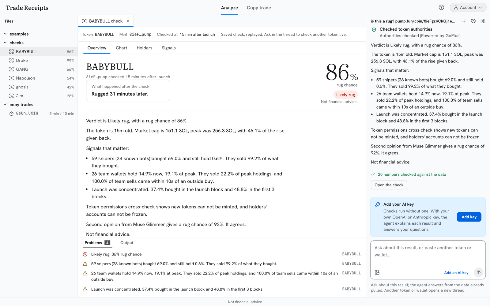
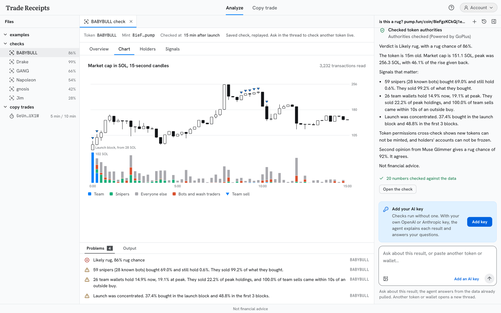
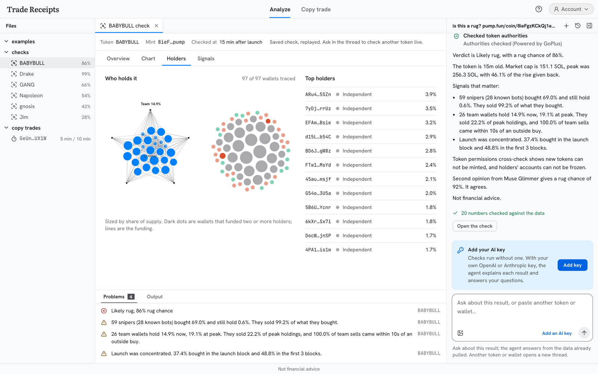
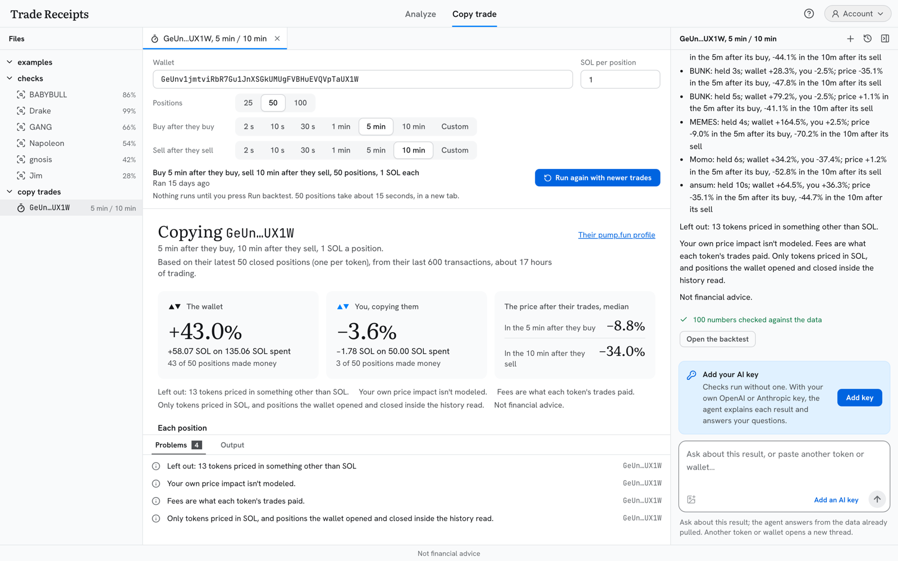

# Trade Receipts

**Check a pump.fun token before you buy it.**

Paste a pump.fun token and Trade Receipts reads every trade since launch, traces where the early wallets got their SOL, works out who the team is, and scores the chance the team rugs. Paste a wallet instead and it backtests copying that trader a few minutes late.

Live at [tradereceipts.io](https://tradereceipts.io). For research and education. Not financial advice.



## Contents

- [What a check finds](#what-a-check-finds)
- [Why we build the holder map ourselves](#why-we-build-the-holder-map-ourselves)
- [What counts as a rug](#what-counts-as-a-rug)
- [The model](#the-model)
- [Copy-trade backtests](#copy-trade-backtests)
- [The agent and the numbers audit](#the-agent-and-the-numbers-audit)
- [Architecture](#architecture)
- [Security](#security)
- [Run it locally](#run-it-locally)
- [Repository map](#repository-map)
- [Data sources](#data-sources)

## What a check finds

A pump.fun token launches on a bonding curve: anyone can buy from the first block, and the price rises with every buy. The people who launch a token can buy too, from as many wallets as they like. The usual rug isn't pulled liquidity, since pump.fun burns the pool's LP tokens when a token graduates. It's the team quietly buying a big share at launch, spread across wallets so no single wallet looks large, then selling it into the buyers who arrive later.

So a check mostly answers one question: **which wallets are really the same person?**

### The steps

1. **Read every trade** that touched the token, from the bonding curve through to PumpSwap after graduation, using Helius.
2. **Trace the funding** of the creator, the first 50 buyers and the 50 biggest holders: who sent each one SOL, and who funded those senders, two hops back.
3. **Link wallets** that share money, and group them into the team, snipers and everyone else.
4. **Measure 81 signals** on the token as it stands right now.
5. **Score the rug chance** with a model trained on 41,956 past pump.fun launches, and show the five most similar past launches and how they ended.
6. **Cross-check the token's authorities** with GoPlus: whether new tokens can be minted, or holders' accounts frozen.

A check takes one to four minutes and about 3,000 Helius credits.

### The terms

| Term | What it means here | How we detect it |
|---|---|---|
| **Bundle** | Several wallets the creator controls buying in the same block the token is created, so the creator's real share is split across addresses | Wallets that bought in the creation slot, minus known sniper bots |
| **Team** | The creator, its bundle, and every wallet linked to them by funding | A `funded` link (one wallet sent the other SOL, directly or through one wallet in between) or a `shared_funder` link (one wallet paid both) |
| **Likely team** | Wallets funded in a way that hides the link: withdrawn from the same exchange, for the same amount, minutes apart | Same busy sender, same amount within 1%, within 10 minutes, in the two days before their first trade. They count as team for the rug label only if they sell alongside it |
| **Sniper** | A wallet that buys in the first 10 seconds | First buy within 10 s of launch. A wallet that has bought that early into 10 or more other tokens is a **sniper bot** |
| **Wash trader** | A wallet that buys and sells back and forth to fake volume | 3+ buys and 3+ sells, with SOL in and out within 10% of each other |
| **Linked round trip** | Two wallets in one cluster trading against each other | A buy within 60 s of a sell by another wallet in the same cluster |
| **Fresh wallet** | A wallet set up just to buy this token | Funded within a day before its first trade here, with no other token trades that day |
| **Selling into buys** | The team selling right after real buyers arrive, so each buy absorbs a sell | A team sell within 10 s of an outside buy |
| **Independent buyer** | Everyone left | Not team, likely team, sniper, wash trader or fresh wallet |

Exchange hot wallets and other busy senders (wallets that paid 200 or more different wallets in the window) never link two wallets; otherwise everyone who withdrew from the same exchange would look like one team. Transfers under 0.01 SOL are ignored as dust and address poisoning.

### The four views

| | |
|---|---|
| **Chart.** Market cap in 15-second candles, with volume colored by who traded: team, snipers, bots and wash traders, everyone else. Team sells are marked. | **Holders.** Left: the team, laid out around the creator, with a line for each funding link. Right: every traced holder, sized by share and colored by group. |
|  |  |

**Overview** (top of this page) has the rug chance, the verdict (Likely, Possible or Unlikely rug), the signals that matter, the second opinion and similar past launches. **Signals** lists every signal family with this token's values. The flags also show in a **Problems** panel, the way an editor lists errors in code.

### Signal families

Each check measures 81 signals (`backend/receipts/crypto/signals.py`):

- **Launch:** the share bought in the launch block and in the first 3 blocks.
- **Team:** its share now and at peak, how much it has sold, and how much of that went into outside buys.
- **Snipers:** how many, how many are known bots, and what they bought, hold and sold.
- **Holders:** the biggest clusters' share, wallets and clusters over 4%, holders with near-identical balances, and supply sold by wallets that never bought it (tokens moved in from elsewhere).
- **Trading:** same-size and round-size buys, wash trading, linked round trips, fresh wallets, and independent buyers' share of buying.
- **Chart:** candle count, share of green candles, how steady the climb was, and the deepest dip.
- **Reputation:** the creator's and team's past launches and rugs, counted only from before this launch.

## Why we build the holder map ourselves

Holder-map services draw clusters with their own wallet-linking, which you can't inspect. You see the picture, not the rules behind it, so you can't tell whether a cluster is missing because the wallets aren't linked or because the service didn't link them. In November 2026, one of the best-known holder-map services was publicly accused of taking money from a tool that helps launches hide their bundles. The service denies it and nothing has been proven, but the dispute shows the problem: when the clustering is a black box, all users can do is trust it.

Trade Receipts doesn't take clusters from any outside service. Every link comes from SOL transfers we read ourselves, under the rules in the table above, and the code is in this repository:

- **Links:** `backend/receipts/crypto/dataset.py` (`_edges`) for training data, `backend/receipts/crypto/live.py` for live checks.
- **Groups:** `backend/receipts/crypto/roles.py`.
- **Training and live checks share the same code.** On 8 test tokens, a live check gave the same verdict as the training snapshot on all 8, and the rug chance moved 0.007 on average (`uv run python -m receipts live-parity`).

If you think a link is wrong, you can read the rule that made it.

## What counts as a rug

**Only the team can rug.** A token is labeled **rugged** when, within 24 hours of launch:

- the team sold at least half of its peak holdings, and
- the price gave back at least 90% of its rise since launch.

On the bonding curve the price can't fall below the launch price, so the fall is measured above it: a token that ran from 28 SOL to 100 SOL and back to 30 has fallen 97%.

A collapse caused by snipers who aren't linked to the team is labeled **faded**, not rugged. Snipers are on almost every launch; if their dumps counted, the model would learn to spot bots instead of a team selling into its own buyers. Sniper activity stays as a signal. A token **survived** when at least 5 wallets are still trading in its last hour and it hasn't fallen 90%.

The 24-hour window comes from the data: 99.2% of rugs in the May launches happened within a day. Code: `backend/receipts/crypto/labels.py`.

## The model

### Training data

There was no usable rug dataset, so we built one from raw chain data.

- **Source:** Google BigQuery's public Solana dataset, queried from the free sandbox. pump.fun's launches, trades and graduations are decoded from the transactions' inner instructions with pump.fun's public IDL.
- **Launches:** 41,956, from May 11–16, 2026, plus Aug 12 and Sep 15 to test months later.
- **Failed transactions** are removed by chaining each bonding-curve trade's reserves to the next, so only trades that really happened count.
- **Snapshots:** each token is rebuilt at 1, 5, 15 and 30 minutes, 1 hour and 6 hours after launch, from only what had happened by then. A token checked at 10 minutes is compared with others at 10 minutes.
- **No look-ahead:** snapshots after a token already rugged are never used. `backend/tests/test_leakage.py` rebuilds snapshots with everything after them deleted and requires identical signals.
- **Split by date,** so the model is always tested on days it never saw:

| Split | Days | Tokens | Snapshots |
|---|---|---|---|
| Train | May 11–14 | 7,849 | 20,848 |
| Tune | May 15 | 2,001 | 5,011 |
| Test | May 16 | 854 | 2,210 |
| Later check | Aug 12, Sep 15 | | 8,408 |

### Results

Measured on May 16, the held-out day. The number is the **fair AUC**: how well a model ranks rugs above non-rugs within the same age and pool type, averaged. A pooled AUC mostly measures age (rug rates fall from 77% at 1 minute to 13% at 6 hours), so we don't lead with it. 0.5 is a coin flip.

| Model | Fair AUC |
|---|---|
| **Gradient-boosted trees** (LightGBM on the 81 signals), every test snapshot | **0.71** |
| **Muse Glimmer, fine-tuned by us**, 300 test snapshots | **0.74** |
| Muse Glimmer before training, same 300 | 0.62 |
| A typical red-flag checklist (10 rules, fixed in advance) | 0.44 |

The trees hold up months later: 0.72 on Aug 12 and 0.70 on Sep 15. **Live checks score with the trees.** The server evaluates the exported trees in plain Python, so it doesn't need LightGBM installed; the scores match LightGBM exactly on 3,000 test rows.

### Muse Glimmer, the second opinion

Muse Glimmer is an open-weight 30B model that reads text and images. We fine-tuned it on Kaggle's free GPUs (2× T4) to read a token the way an analyst would: its signals, its 20 biggest holders and how each was funded, the price line, SOL bought and sold by each group over time, and the holder map as an image. The order of events is often the tell: small identical buys, then outside buyers, then the team selling into every buy.

- **Stage 1, fine-tuning:** 900 snapshots, with answers taught by the trees' calibrated rug chance and the signals that moved it most.
- **Stage 2, reinforcement learning (GRPO):** 900 more. For each snapshot Glimmer samples 8 rug chances, each rewarded by its Brier score against what really happened. That rewards being right and being honestly confident.
- **LoRA** rank 8 on the 4-bit base, 52M trainable parameters, 8-bit AdamW.

Saved checks show its rug chance next to the trees'. Code: `backend/kaggle/glimmer_job.py`, `backend/receipts/crypto/prompt.py`, `glimmer_eval.py`.

## Copy-trade backtests

Influencers and leaderboard traders post their wins. You only see a trade after they make it, so the useful question is what you'd have made following them a little late.



Paste a pump.fun wallet, pick how long after their buy you'd buy, how long after their sell you'd sell, and how many of their latest closed positions to copy (25, 50 or 100). `backend/receipts/crypto/copytrade.py`:

1. Reads the wallet's latest transactions and finds its closed pump.fun positions, one per token.
2. Prices every fill as a market cap in SOL, from the token's own trades.
3. Buys that long after each of their buys, at the price then, and sells the same share that long after each of their sells.
4. Charges the fees each token's trades actually paid.
5. Reports their result, yours, how many positions made money, and the median price move while you waited.

In the saved example the wallet made **+43.0%** over 50 positions. Copying it 5 minutes after each buy and 10 minutes after each sell made **−3.6%**: by the time you'd have bought, the price had already moved a median −8.8%.

Not modeled: your own price impact. Left out: tokens priced in something other than SOL, and positions opened before the history read.

## The agent and the numbers audit

The chat runs an agent on the visitor's own OpenAI or Anthropic key (`backend/receipts/agent/`). Its tools:

| Tool | What it does |
|---|---|
| `find_token` | Finds a token by ticker or name |
| `check_token` | The live rug check |
| `token_security` | GoPlus token authorities |
| `copy_trade` | The copy-trade backtest |
| `read_address` | Reads a token's address from a screenshot |

**Numbers come from tools, never from the model.** Before an answer is shown, `audit.py` matches every number in it against the tool outputs, and the answer says how many it checked ("20 numbers checked against the data"). Follow-up questions are answered from the data already pulled.

Without a key, checks and backtests still run and show their findings; there's just no written explanation.

## Architecture

```
Browser: React, Vite, TypeScript             tradereceipts.io (Cloudflare Pages)
  IDE: files · check and backtest tabs · Problems · chat
    │  HTTPS, server-sent events, Supabase access token
    ▼
FastAPI, Python 3.13                          api.tradereceipts.io (Vercel)
  /api/agent       agent (visitor's key) ─┬─ check_token ──── live.py ──────── Helius
  /api/check       live rug check         ├─ token_security ───────────────── GoPlus
  /api/copytrade   backtest               ├─ copy_trade ───── copytrade.py ── Helius
  /api/demo        saved runs             └─ numbers audit
    │
    └─ the same dataset, label and signal code as training

Training (offline): BigQuery Solana ─► decode ─► labels ─► snapshots
                    ─► LightGBM trees · Muse Glimmer (LoRA SFT, then GRPO) on Kaggle T4s
```

- **Frontend:** React 19, Vite, TypeScript, react-resizable-panels, a custom Plotly bundle for charts, Supabase Auth.
- **Backend:** FastAPI, DuckDB, PyArrow, httpx. Training-only libraries (LightGBM, scikit-learn, BigQuery, Pillow) sit in a separate `train` dependency group, so the deployed API stays small.

## Security

- **Your AI key** stays in your browser and goes only with your own requests, as a header. The server uses it for that request and never stores or logs it.
- **Server keys** (Helius) live only in the host's environment settings. `.env` is gitignored, and error text passes through a redactor so a key in a failed request URL never reaches a response or a log.
- **Sign-in:** the API checks each Supabase access token with Supabase and caches the result for 5 minutes.
- **Rate limits:** 6 live checks an hour per account, 60 a day across the site, 30 follow-ups an hour. Live tools the agent calls count against the same limits.
- **Headers:** the built site sends a strict Content-Security-Policy (scripts only from its own origin; network calls only to itself, the API and Supabase), plus HSTS, `X-Frame-Options: DENY`, `nosniff` and a locked-down Permissions-Policy (`frontend/vite.config.ts`).
- **CORS:** the API accepts only the origins in `ALLOWED_ORIGINS`.

Found a security problem? Please report it through a private security advisory on GitHub, not a public issue.

## Run it locally

You need Node 22+, Python 3.13 with [uv](https://docs.astral.sh/uv/), and a free [Helius](https://dashboard.helius.dev) key for live checks.

1. Copy `.env.example` to `.env` in the repo root and add your `HELIUS_API_KEY`. Leave the Supabase variables unset and nobody needs to sign in.
2. Backend:

   ```bash
   cd backend && uv sync && uv run uvicorn receipts.server:app --port 8000
   ```

3. Frontend, in another terminal:

   ```bash
   cd frontend && npm install && npm run dev
   ```

4. Open http://localhost:5173. The IDE reaches the backend through Vite's `/api` proxy.

The saved example checks are derived chain data, so they aren't in the repo; without them the IDE starts empty, and live checks work the same. Rebuilding the training data needs `GOOGLE_CLOUD_PROJECT` (a free BigQuery sandbox). Training Glimmer needs `HF_TOKEN` and `KAGGLE_API_TOKEN`.

**Tests**

```bash
cd backend && uv run pytest
```

```bash
cd frontend && npm run typecheck
```

**Command line** (from `backend/`: `uv run python -m receipts <command>`):

| Command | What it does |
|---|---|
| `live-check <mint>` | A live rug check |
| `copy-trade <wallet> --buy-after 300 --sell-after 600` | A copy-trade backtest |
| `agent "<message>"` | The agent on one message |
| `goplus <mint>` | GoPlus token authorities |
| `pull-block`, `pull-funding`, `wallet-history` | Pull launches, funding and wallet history from BigQuery |
| `build-dataset may aug sep` | Build tokens, links, labels and snapshots |
| `train-baselines` | Train and test the checklist and the trees |
| `glimmer-data`, `glimmer-eval` | Write Glimmer's prompts; score its predictions |
| `live-parity` | Compare live checks with their training snapshots |

To deploy your own copy, see [docs/deploy.md](docs/deploy.md).

## Repository map

| Path | What's there |
|---|---|
| `frontend/src/pages/` | Home, sign-up and IDE pages |
| `frontend/src/ide/` | The IDE: chat, check and backtest tabs, files, tour, settings |
| `frontend/src/demo/` | Charts, the holder map, result views, saved-run replays |
| `backend/receipts/server.py` | The HTTP API |
| `backend/receipts/auth.py` | Sign-in check and per-account limits |
| `backend/receipts/agent/` | Agent loop, numbers audit, the client for the visitor's model |
| `backend/receipts/crypto/` | Data pipeline, links, roles, labels, signals, models, live checks, copy trade |
| `backend/kaggle/` | Glimmer's training and scoring job |
| `backend/deploy/` | Packaging for Vercel |
| `backend/tests/` | Tests, including the leakage test |

The repo also holds the start of a stock-strategy backtester (the code-editor views and their examples). It isn't on the site yet.

## Data sources

| Source | Used for | Terms |
|---|---|---|
| Google BigQuery public Solana dataset | Training history | Public dataset, free sandbox |
| Helius | Live checks and backtests | Free plan |
| GoPlus | Token authorities | Free, credited as "Powered by GoPlus" |
| DEX Screener | Finding a token by name or ticker | Free public API |
| pump.fun IDL | Decoding pump.fun events | Public |
| Muse Glimmer | The second-opinion model | Open weights |

Raw third-party data stays out of the repository (`data/` is gitignored). The MELT dataset's rug definitions informed our labels; its data isn't trained on, because its license is non-commercial.

---

**For research and education. Not financial advice.** A low rug chance doesn't mean a token is safe to buy.
